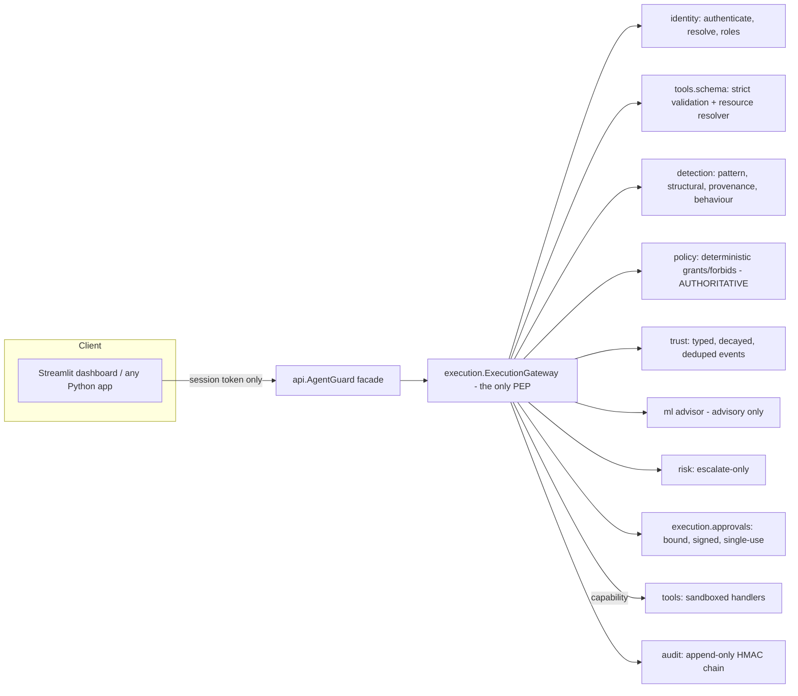

# Architecture

## Decision pipeline
`resolve identity -> replay check -> rate limit -> tool lookup -> strict schema -> resource classification -> detectors -> POLICY -> trust + ML -> risk -> most_restrictive(policy, risk) ->`
`DENY | approval request | revalidate identity+policy -> audit(start) -> execute with capability -> output checks (canary, redaction, injection scan, untrusted wrapper) -> audit(complete)`.

Invariants (each has tests and mutation-tested guards):
1. Policy is evaluated on the server-side role; client claims are logged, never consulted.
2. Risk can only tighten: `final = most_restrictive(policy, risk)`; ML adds at most 15 points and cannot cause DENY or relax anything.
3. Explicit forbids and policy denials return before risk is consulted.
4. Failure of identity/policy => DENY. Failure of trust/ML/detectors/audit => protected operations escalate or are blocked; nothing silently allows.
5. A tool handler runs only with a single-use capability bound to (tool, canonical-args hash), minted solely by the gateway, and after execution-time revalidation.
6. A denied request produces no side effect (asserted by sandbox snapshots).

## Module map
| Module | Responsibility |
|---|---|
| `identity/` | scrypt auth, lockout, session tokens (hash-stored), server-side roles, immutable `user_id` |
| `policy/` | versioned grants/forbids/approvers, default deny |
| `tools/` | specs, strict schema, resolvers, sandboxed demo tools, weather providers, sandbox seed |
| `detection/` | normalisation, patterns, structural, provenance, behaviour, leakage/redaction, untrusted wrapper |
| `trust/` | event types, decay, caps, negation, dedupe, replay claims |
| `risk/` | explainable factors + escalation rules |
| `execution/` | gateway, capability, approvals |
| `audit/` | structured events, hash chain, search, verification |
| `ml/` | corpus, features, training, metrics, JSON model, registry, runtime advisor |
| `agent/` | untrusted keyword planner |
| `api/` | facade incl. role-gated read APIs, review, labels, model lifecycle |
| `benchmark/` | scenarios, harness, runner, reports |
| `dashboard/` | Streamlit client; enforces nothing |

Deviation from the suggested layout: there is no separate `context/` package. Request normalisation is the schema + resource resolver (`tools/`) and
`ToolCallRequest` (`common.py`); a package with no distinct logic would have been an empty module.

## What adapts at runtime vs. what changes only through approved updates
| Adapts at runtime (deterministic, documented) | Changes only via controlled workflow |
|---|---|
| Per-user trust score from verified/typed events with decay | ML model weights (train -> gate -> human approval -> activation, rollback available) |
| Rate/behaviour counters | Policy bundle (version-bumped; invalidates pending approvals) |
| Approval state | Detector pattern sets (code change + tests) |
| Audit log | Labels (human reviewer + evidence; model output rejected as a source) |

Nothing in the request path writes to a model, a dataset, or a label table.

## Trust engine behaviour under bad data
| Condition | Behaviour |
|---|---|
| No history | score 1.0, level NORMAL; `new_account` flag (first 24h) adds +5 risk to side-effecting calls only |
| Store unavailable | snapshot `UNAVAILABLE`/UNKNOWN: protected ops escalate to approval; read-only low-risk proceeds |
| Future-dated, unknown-type, or forged verified-only events | ignored for scoring; `data_quality=INCONSISTENT` => treated as unknown, not clean |
| Replayed events | unique dedupe key; no penalty inflation |
| False positive | reviewer negation event removes the penalty; automated penalties also decay (hours to days) |
| Possible manipulation | table is append-only (triggers); corrections are new events. Anyone with raw DB access can still bypass triggers - see audit chain/LIMITATIONS |

## Audit and incident model
Every decision/execution/approval/review/model event is one structured record (event id, ts, principal, session, request, tool, action, resource class,
outcome, **outcome class** [POLICY_DENIAL | RISK_ESCALATION | OPERATIONAL_FAILURE | SUSPECTED_MALICIOUS | CONFIRMED_MALICIOUS], reason codes, signals,
trust transition, detector/model versions, approval/exec status). Raw prompts are never stored; request text is stored as a SHA-256 plus redacted short excerpts of matched patterns (configurable).
`CONFIRMED_MALICIOUS` can only be produced by a human review event.

## Migration path to PostgreSQL
`db.py` isolates connection handling and migrations; SQL is portable. Steps: (1) implement a `Database` for psycopg with the same `tx/read/migrate`;
(2) replace `BEGIN IMMEDIATE` with `SERIALIZABLE` or advisory locks for the audit-chain append; (3) give the application role INSERT-only on `audit_events`/`trust_events`
and enforce append-only with REVOKE UPDATE/DELETE plus a trigger; (4) ship audit rows to external WORM storage and anchor chain heads; (5) move the HMAC key to a KMS.
